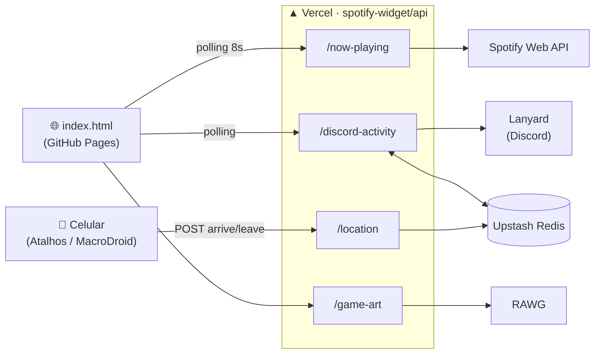

<div align="center">


# Erick│Dev — Mini Portfólio

**Um cartão de visitas digital que mostra, em tempo real, o que estou fazendo agora.**

[](https://erickaocode.github.io/Mini-Portfolio/)
[](https://erickaocode.github.io/Portfolio/)


</div>

---

## ✨ O que tem aqui

| | Recurso | Como funciona |
|---|---|---|
| 🎬 | **Intro animada** | Painéis com "Erick" e "Dev" se abrem ao carregar a página. |
| 🔤 | **Efeito scramble** | O nome embaralha uma vez na entrada, e o cargo alterna entre frases com o mesmo efeito. |
| 🎧 | **Trilha do momento** | Mostra a música que está tocando no Spotify, com capa, artista e barra de progresso animada. Sem nada tocando, mostra a última música ouvida. |
| 🎮 | **Agora (Discord)** | Exibe a atividade atual do Discord (jogo, app etc.) com a arte do jogo puxada da RAWG. Quando a atividade acaba, mostra "Visto por último há Xh Ymin". |
| 🏋️ | **Status "Treinando"** | O celular avisa quando chego e saio da academia (geofence) e o card troca para "Treinando". |
| 🟢 | **Status de presença** | Indicador ao lado da foto: Online, Ausente, Não perturbe ou Offline. |
| ♿ | **Acessível** | Respeita `prefers-reduced-motion`, usa `aria-label` e funciona sem JavaScript (`<noscript>`). |

---

## 🧭 Arquitetura

O front-end é estático (GitHub Pages) e consome uma pequena API serverless na Vercel, que conversa com os serviços externos e esconde as credenciais.



---

## 🔌 Endpoints

Todos ficam em [`spotify-widget/api/`](spotify-widget/api/) e respondem JSON com CORS liberado.

| Rota | Método | Descrição |
|---|---|---|
| [`/api/now-playing`](spotify-widget/api/now-playing.js) | `GET` | Música atual (ou a última ouvida): `isPlaying`, `title`, `artist`, `album`, `albumArt`, `songUrl`, `progressMs`, `durationMs`. |
| [`/api/discord-activity`](spotify-widget/api/discord-activity.js) | `GET` | Presença do Discord via Lanyard: `discordStatus`, `activity`, `seenAt`, `isCurrent`, `location`. Guarda a última atividade no Redis, com 45s de tolerância contra falhas passageiras. |
| [`/api/game-art`](spotify-widget/api/game-art.js) | `GET ?name=` | Capa do jogo buscada na RAWG, com cache de 24h. |
| [`/api/location`](spotify-widget/api/location.js) | `POST` | Recebe `{ "action": "arrive" \| "leave" }` com `Authorization: Bearer <LOCATION_SECRET>`. O status expira sozinho após 3h. |

> 🔒 **Privacidade:** o geofence é feito no próprio celular. A API só recebe "entrei" ou "saí", nunca coordenadas nem o nome do lugar.

---

## 📁 Estrutura

```text
.
├── index.html              # Página + scripts dos widgets
├── styles.css              # Estilos, animações e responsividade
├── Img/                    # Foto de perfil e favicon
└── spotify-widget/         # API serverless (Vercel)
    ├── api/
    │   ├── now-playing.js
    │   ├── discord-activity.js
    │   ├── game-art.js
    │   └── location.js
    ├── get-refresh-token.js  # Script único para gerar o refresh token do Spotify
    └── package.json
```

---

## 🚀 Rodando o projeto

### Front-end

Não precisa de build. Basta abrir o `index.html` no navegador ou usar um servidor local:

```bash
npx serve .
```

### API (Vercel)

1. **Crie um app no Spotify** em [developer.spotify.com/dashboard](https://developer.spotify.com/dashboard) e cadastre o Redirect URI `http://127.0.0.1:8888/callback`.
2. **Gere o refresh token** (só é preciso uma vez):

   ```bash
   cd spotify-widget
   SPOTIFY_CLIENT_ID=xxx SPOTIFY_CLIENT_SECRET=yyy node get-refresh-token.js
   ```

3. **Configure as variáveis de ambiente** na Vercel:

   | Variável | Obrigatória | Uso |
   |---|---|---|
   | `SPOTIFY_CLIENT_ID` | ✅ | App do Spotify |
   | `SPOTIFY_CLIENT_SECRET` | ✅ | App do Spotify |
   | `SPOTIFY_REFRESH_TOKEN` | ✅ | Gerado no passo 2 |
   | `UPSTASH_REDIS_REST_URL` | ➖ | Última atividade e status "Treinando" |
   | `UPSTASH_REDIS_REST_TOKEN` | ➖ | Última atividade e status "Treinando" |
   | `RAWG_API_KEY` | ➖ | Capas dos jogos |
   | `LOCATION_SECRET` | ➖ | Protege o endpoint `/location` |

4. **Faça o deploy:**

   ```bash
   cd spotify-widget
   vercel --prod
   ```

5. **Aponte o front-end para a sua API**, ajustando as constantes `SPOTIFY_ENDPOINT`, `DISCORD_ACTIVITY_ENDPOINT` e `GAME_ART_ENDPOINT` no `index.html`.

> ⚠️ Nunca suba `.env` nem tokens para o repositório. Eles já estão no `.gitignore`.

---

<div align="center">

Feito com ☕ e 🎧 por **[Erick Silva](https://github.com/Erickaocode)**

[](https://github.com/Erickaocode/)
[](https://www.linkedin.com/in/erick-silva-8579002b0/)
[](https://www.instagram.com/_erickz77_/)

</div>
